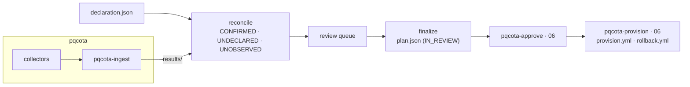

[English](README.md) · 한국어

# pqcaton

**개요** · [릴리스 노트](RELEASE_NOTES.ko.md) · [여정](docs/journey.ko.md) · [설계](docs/developers.ko.md) · [검증 기준](docs/testcases.ko.md) · [데모](demo/README.ko.md) · [구조 그림](#한-그림으로)

**PQC 이관에서 무엇을 바꿀지 정하는 자리입니다.** [pqcota](https://github.com/randyinthedev-hash/pqcota)가 시스템이 쓰는 암호를
관측하면, pqcaton은 **그 관측을 조직이 선언한 것과 대조하고, 결정이 필요한 것을 리뷰 큐에 올리고, 사람이 내린 판정을 확정해**
pqcota가 승인하고 실행할 수 있는 계획으로 만듭니다. 이 판은 pqcota **v0.16.0**과 함께 씁니다([판별 표](docs/compatibility.ko.md)).

> **소스 공개(source-available)이지 오픈소스가 아닙니다.** [BUSL-1.1](LICENSE)입니다. 관리 노드 5대까지 무료이고 그 이상은
> 계약이며, **각 릴리스가 4년 뒤 Apache-2.0으로 전환됩니다**([라이선스 안내](docs/licensing.ko.md)).

## 이 문서의 독자

- 조직 안에서 PQC 이관을 운영하면서 **누가 언제 무엇을 근거로 정했는지 보여야 하는 운영자**
- 무엇이든 바꾸기 전에 **아무도 선언하지 않은 통신을 먼저 보려는 보안팀**
- 계획을 받아 **조치마다 관측과 사람의 판정까지 되짚어야 하는 승인자와 감사자**

코드를 읽지 않아도 됩니다. 화면(`pqcaton-ui`)이 단계를 따라 안내하고, 명령은 같은 일을 스크립트에서 합니다.

## 제공하는 결과

| 받는 것 | 무엇인가 |
|---|---|
| **3-상태 인벤토리** | 모든 자산과 연결을 CONFIRMED(선언했고 관측됨) · UNDECLARED(관측만, 조직이 모르는 것) · UNOBSERVED(선언만, 사람이 판정할 것)로 나눕니다 |
| **리뷰 큐** | 사람의 결정이 필요한 것입니다. 정책 단위로 일괄 판정하고, 필요한 곳은 하나씩 봅니다 |
| **판정된 계획**(`plan.json`) | pqcota의 계약 형식 그대로이고 상태는 `IN_REVIEW`이며, 조치마다 근거가 된 스냅샷을 담습니다. 실행 승인은 별도 단계로 남습니다 |
| **덧붙이기만 하는 판정 원장** | 누가 언제 무엇을 왜 판정했는지 남고, 근거가 바뀐 판정만 다시 봅니다 |
| **승인된 자산 스코프**(`asset-scope.csv`) | 「이 자산은 안 본다」도 다른 판정처럼 승인을 거치며, pqcota 집행기의 입력이 됩니다 |

## 세 단계

1. **선언과 관측.** 조직이 실제로 돌린다고 아는 것을 적습니다(CMDB에서 뽑거나 손으로). pqcota가 노드를 관측하고 결과를 적재합니다.
2. **대조와 리뷰.** pqcaton이 관측과 선언을 3-상태로 맞대고, 결정이 필요한 것을 리뷰 큐에 올립니다. 사람이 정책 단위나 항목
   단위로 판정합니다.
3. **확정과 넘김.** 필수 판정과 서명이 모두 있어야 확정 관문을 지납니다. 계획은 pqcota의 승인 · 생성(`pqcota-approve` ·
   `pqcota-provision`)으로 넘어가거나, 같은 기계에서 06 화면을 거칩니다.

### 한 그림으로



의존은 **한 방향**입니다. pqcaton은 pqcota의 공개 모듈을 가져다 쓰고, pqcota는 pqcaton에 의존하지 않습니다. pqcota는 그 자체로
완결됩니다. 더 자세한 구조 설명은 [docs/index.html](docs/index.html)에 있습니다.

## 빠른 시작

pqcaton 화면을 사용하려면 먼저 pqcota 이력용 PostgreSQL에 스키마와 조회 권한을 준비하고, `PQCOTA_DSN` 또는 `pqcota.env`로
연결 정보를 설정해야 합니다. 화면은 시작할 때 연결과 필수 조회를 확인합니다. 처음 사용하는 분은 아래
[데모 절차](#데모로-써-보기)를 따르거나, 운영자 안내서의 [pqcota 준비](docs/operator-guide.ko.md#pqcota-준비)부터 진행하십시오.

| 길 | 이럴 때 | 끝나면 |
|---|---|---|
| [데모로 써 보기](#데모로-써-보기) | pqcota가 아직 없고, 먼저 한 바퀴 돌려 볼 때 | Docker로 띄운 노드 세 대와 pqcota 이력으로 01~06 화면을 한 바퀴 돕니다 |
| [이 리포 빌드하기](#이-리포-빌드하기) | 내 노드를 관측하고 판정할 때 | 내 pqcota 이력에 연결된 화면이 뜹니다 |

<a id="써보기"></a>

### 데모로 써 보기

결제 서비스를 흉내 낸 노드 세 대를 Docker로 띄우고(상류 pqcota의 데모), 그 위에서 pqcaton을 돌립니다. pqcota 이력도 데모가
만듭니다.

**필요한 것.** **Linux x86-64**(데모의 종단 검증을 한 곳입니다. macOS는 검증하지 않았습니다), Git, **Go**([`go.mod`](go.mod)에 적힌
판), **Docker**, python3, **`gh`**(GitHub CLI 2.49 이상, `gh auth login`으로 로그인. 공식 수집기의 출처 증명을 확인할 때 씁니다).

**받기.** 이 리포와 상류 pqcota **v0.16.0**의 리포 다섯 개를 한 폴더 아래에 나란히 받습니다.

```bash
mkdir pqcaton-demo && cd pqcaton-demo
git clone --branch v0.31.0 https://github.com/sntsoftgit/pqcaton
for r in pqcota pqcota-common pqcota-inventory pqcota-discovery pqcota-provisioning; do git clone --branch v0.16.0 https://github.com/randyinthedev-hash/$r; done
cd pqcaton/demo
```

**다음.** 그 폴더(`pqcaton/demo`)에서 데모 안내의 [실행](demo/README.ko.md#실행) 절을 따릅니다. 끝나면
`http://127.0.0.1:8765`에서 화면이 열립니다. 화면마다 무엇을 하는지는
[화면을 차례로 지나기](demo/README.ko.md#화면을-차례로-지나기)에 있습니다.

### 이 리포 빌드하기

pqcota 저장소를 별도로 받아 빌드할 필요는 없습니다. 아래 명령은 pqcaton을 빌드하고 도움말을 확인합니다. 화면을 실행하려면
위의 이력 DB 준비가 필요합니다.

```bash
git clone --branch v0.31.0 https://github.com/sntsoftgit/pqcaton
cd pqcaton
go build -o bin/ ./inventory/cmd/...
./bin/pqcaton-ui -h
```

마지막 줄이 도움말을 보이면 빌드된 것입니다. 도움말을 찍은 뒤 종료 코드 2로 끝나는 것은 정상입니다(`set -e`를 쓰는
스크립트에서는 이 줄에서 멈춥니다). 명령은 `bin/`에 만들어지므로 `./bin/...`로 실행합니다(또는 `PATH`에 있는 폴더로
옮깁니다).

**화면 띄우기.** 운영자 안내서 [2절 「pqcota 준비」](docs/operator-guide.ko.md#pqcota-준비)의 1~5단계를 마친 뒤
`./bin/pqcaton-ui -no-browser`를 실행합니다. `screen: http://127.0.0.1:8765/  (workspace …)` 줄이 나오면 화면이 뜬 것입니다.
03 관측과 06 승인 서명에 필요한 준비도 [같은 2절](docs/operator-guide.ko.md#2-설치)에 있습니다.

**빌드한 명령.**

| 명령 | 하는 일 |
|---|---|
| `pqcaton-ui` | 화면(01 선언부터 06 승인 · 생성까지) |
| `pqcaton-decide` | 같은 판정 단계를 명령으로(`open` · `close` · `delta`) |
| `pqcaton-report` | 모은 결과로 대조 보고서와 거버넌스 토폴로지를 만듭니다 |
| `pqcaton-scope` | 자산 스코프 정책(계층 · 확정 · 활성화)을 명령으로 |
| `pqcaton-collectors` | 상류 공식 수집기를 받고 확인합니다 |

화면 없이 명령으로 한 바퀴 도는 방법은 [명령으로 한 바퀴](docs/journey.ko.md#명령으로-한-바퀴)에 있습니다. 코드를 고칠 때는
`make`를 씁니다. 리포의 관문을 먼저 돌린 뒤 빌드하고 시험합니다([빌드](docs/build.ko.md)).

**받은 상류 모듈의 자리.** `go build`는 [`go.mod`](go.mod)에 적힌 상류 pqcota 모듈 넷도 함께 받습니다. 받은 모듈은 클론한 폴더가
아니라 Go 모듈 캐시에 저장됩니다. 기본 위치는 `~/go/pkg/mod`이고, `go env GOMODCACHE`로 확인할 수 있습니다. 캐시는 이 기계의
Go 프로젝트가 함께 쓰고 파일이 읽기 전용이라, 비울 때는 `rm` 대신 `go clean -modcache`를 씁니다. 그러면 모든 프로젝트의 캐시가
지워지고, 다음 빌드 때 다시 받습니다.

## 다음에 읽을 것

| 하려는 것 | 읽을 곳 |
|---|---|
| 설치하고 매일 운영한다 | [운영자 안내서](docs/operator-guide.ko.md) |
| 명령까지 처음부터 끝까지 따라간다 | [여정](docs/journey.ko.md) |
| 왜 이렇게 만들었는지 본다 | [설계](docs/developers.ko.md) · [검증 기준](docs/testcases.ko.md) |
| pqcota 데모 위에서 돌려 본다 | [데모](demo/README.ko.md) |
| pqcota 판을 고른다 | [판별 표](docs/compatibility.ko.md) |
| 소스에서 빌드하거나 환경 변수를 찾아본다 | [빌드](docs/build.ko.md) · [환경 변수](docs/environment-variables.ko.md) |
| 호스팅에서 무엇이 밖으로 나가는지 본다 | [`saas/runner`](saas/runner/README.md) |
| 고친 것을 보내거나 취약점을 알린다 | [CONTRIBUTING](CONTRIBUTING.ko.md) · [CLA](CLA.ko.md) · [SECURITY](SECURITY.ko.md) |

## 맞는 조합

이 리포는 pqcota **v0.16.0**(`pqcota-common` · `pqcota-inventory` · `pqcota-discovery` · `pqcota-provisioning` 넷을 같은 태그로,
`go.mod`가 고정)으로 만들고 그 판으로 종단 검증했습니다. pqcaton은 자기 안에 든 규칙 묶음(`pqcota-enrich/v4`)으로
관측을 정규화하고 그 스냅샷 지문을 계획의 근거로 싣습니다. 그래서 상류의 `pqcota-ingest`와 `pqcota-provision`도 같은 규칙 묶음이어야
합니다. 규칙 묶음이 v3인 pqcota v0.10.6 ~ v0.11.0에는 pqcaton [v0.28.0](https://github.com/sntsoftgit/pqcaton/tree/v0.28.0)을, v0.10.5
이하에는 pqcaton [v0.24.1](https://github.com/sntsoftgit/pqcaton/tree/v0.24.1)을 씁니다. 모든 조합은 [판별 표](docs/compatibility.ko.md)에 있습니다.

## pqcaton이 하지 않는 것

| 하지 않는 것 | 대신 |
|---|---|
| 수집 | pqcota의 수집기가 관측합니다. 화면은 운영자의 Ansible로 그것을 실행할 뿐입니다 |
| 변경 적용 | 화면은 pqcota 생성기로 플레이북을 만들 뿐이고, 적용은 운영자의 Ansible이 합니다 |
| 대신 판정 | 판정할 것을 구조화할 뿐, **확정은 사람이 합니다** |
| UNOBSERVED 확정 | 실재하는데 못 본 것인지 이미 없어진 것인지는 사람만 압니다 |

## 라이선스

Copyright 2026 (주)에스앤티소프트 (SNT Soft Co., Ltd.). 저작권자는 [AUTHORS](AUTHORS)에 적혀 있습니다.

[**BUSL-1.1**](LICENSE) · **각 릴리스가 공개일로부터 4년 뒤 Apache-2.0으로 전환됩니다.** 버전별 전환일은
[릴리스 노트](RELEASE_NOTES.ko.md)에 있습니다(v0.1.0~v0.5.0은 2030-08-11).

- 평가·개발·테스트는 규모 제한 없이 무료
- 프로덕션은 관리 노드 5대까지 무료
- 그 이상은 계약: **kty@sntsoft.co.kr**

자세한 것은 [라이선스 안내](docs/licensing.ko.md)에 있습니다. 기반 프로젝트 pqcota는 Apache-2.0이고, 귀속 고지는 [NOTICE](NOTICE)에
있습니다. 문서는 영어가 기본이고 한국어는 짝 파일(`*.ko.md`)입니다. CLA는 한국어 원문([CLA.ko.md](CLA.ko.md))이 우선합니다.

---

(주)에스앤티소프트
