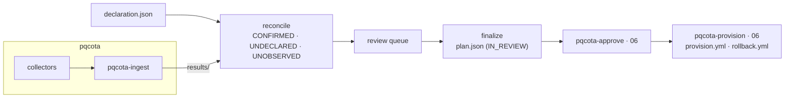

[English](README.md) · 한국어

# pqcaton

**개요** · [릴리스 노트](RELEASE_NOTES.md) · [여정](docs/journey.ko.md) · [설계](docs/developers.ko.md) · [검증 기준](docs/testcases.ko.md) · [데모](demo/README.ko.md) · [구조 그림](#한-그림으로)

**PQC 이관에서 무엇을 바꿀지 정하는 자리입니다.** [pqcota](https://github.com/randyinthedev-hash/pqcota)가 시스템이 쓰는 암호를
관측하면, pqcaton은 **그 관측을 조직이 선언한 것과 대조하고, 결정이 필요한 것을 리뷰 큐에 올리고, 사람이 내린 판정을 확정해**
pqcota가 승인하고 실행할 수 있는 계획으로 만듭니다. 이 판은 pqcota **v0.11.0**과 함께 씁니다([판별 표](docs/compatibility.ko.md)).

> **소스 공개(source-available)이지 오픈소스가 아닙니다.** [BUSL-1.1](LICENSE)입니다. 관리 노드 5대까지 무료이고 그 이상은
> 계약이며, **각 릴리스가 4년 뒤 Apache-2.0으로 전환됩니다**([라이선스 안내](docs/licensing.ko.md)).

## 이 문서의 독자

- 조직 안에서 PQC 이관을 운영하면서 **누가 언제 무엇을 근거로 정했는지 보여야 하는 운영자**
- 무엇이든 바꾸기 전에 **아무도 선언하지 않은 통신을 먼저 보려는 보안팀**
- 계획을 받아 **조치마다 관측과 사람의 판정까지 되짚어야 하는 승인자와 감사자**

코드를 읽지 않아도 됩니다. 화면(`pqcaton-ui`)이 단계를 따라 안내하고, 명령은 같은 일을 스크립트에서 합니다.

## 제공하는 결과

| 받는 것 | 무엇인가 |
|---|---|
| **3-상태 인벤토리** | 모든 자산과 연결을 CONFIRMED(선언했고 관측됨) · UNDECLARED(관측만, 조직이 모르는 것) · UNOBSERVED(선언만, 사람이 판정할 것)로 나눕니다 |
| **리뷰 큐** | 사람의 결정이 필요한 것입니다. 정책 단위로 일괄 판정하고, 필요한 곳은 하나씩 봅니다 |
| **판정된 계획**(`plan.json`) | pqcota의 계약 형식 그대로이고 상태는 `IN_REVIEW`이며, 조치마다 근거가 된 스냅샷을 담습니다. 실행 승인은 별도 단계로 남습니다 |
| **덧붙이기만 하는 판정 원장** | 누가 언제 무엇을 왜 판정했는지 남고, 근거가 바뀐 판정만 다시 봅니다 |
| **승인된 자산 스코프**(`asset-scope.csv`) | 「이 자산은 안 본다」도 다른 판정처럼 승인을 거치며, pqcota 집행기의 입력이 됩니다 |

## 세 단계

1. **선언과 관측.** 조직이 실제로 돌린다고 아는 것을 적습니다(CMDB에서 뽑거나 손으로). pqcota가 노드를 관측하고 결과를 적재합니다.
2. **대조와 리뷰.** pqcaton이 관측과 선언을 3-상태로 맞대고, 결정이 필요한 것을 리뷰 큐에 올립니다. 사람이 정책 단위나 항목
   단위로 판정합니다.
3. **확정과 넘김.** 필수 판정과 서명이 모두 있어야 확정 관문을 지납니다. 계획은 pqcota의 승인 · 생성(`pqcota-approve` ·
   `pqcota-provision`)으로 넘어가거나, 같은 기계에서 06 화면을 거칩니다.

### 한 그림으로



의존은 **한 방향**입니다. pqcaton은 pqcota의 공개 모듈을 가져다 쓰고, pqcota는 pqcaton에 의존하지 않습니다. pqcota는 그 자체로
완결됩니다. 더 자세한 구조 설명은 [docs/index.html](docs/index.html)에 있습니다.

## 빠른 시작

<a id="써보기"></a>

**Go**([`go.mod`](go.mod)에 적힌 판)가 필요하고, 관측 · 승인 · 생성에는 다섯 리포를 같은 태그로 둔 pqcota **v0.11.0**이 필요합니다.
Graphviz(`dot`)는 선택이며, 없으면 토폴로지를 DOT 원문으로 냅니다.

**이 기계로 한 바퀴(리눅스).** 이 지름길은 이 기계 자신을 스캔합니다(`/proc`). macOS · Windows에서는 pqcota가 모은 `results/`로
대조합니다.

```bash
make
go build -o bin/ ./inventory/cmd/...
printf 'node,runtime,component\nlocal,openssl,libssl\nlocal,jca,jca-provider-chain\n' > decl.csv
bin/pqcaton-decide open decl.csv local > session.json
bin/pqcaton-decide close session.json -o plan.json -judgments judgments.jsonl -org acme
bin/pqcaton-decide delta judgments.jsonl decl.csv local -org acme
```

`open`과 `close` 사이에 사람이 `session.json`(또는 화면)에서 결론 · 검토자 · 서명을 채웁니다. 필수 항목이 모두 판정되기 전에는
`close`가 거절하고 무엇이 남았는지 알려 줍니다.

**화면으로.** 인자 없이 `pqcaton-ui`를 띄우면 홈의 `pqcaton` 작업 폴더를 쓰고 브라우저를 엽니다. **pqcota 이력 없이는 시작하지
않습니다**: 셸의 `PQCOTA_DSN`이나 사용자 설정 폴더의 `pqcota.env`가 있어야 합니다. 설치 · 서비스 · 백업 · 복구 · 오류 표는
[운영자 안내서](docs/operator-guide.ko.md)에 있습니다.

```bash
pqcaton-ui
```

## 다음에 읽을 것

| 하려는 것 | 읽을 곳 |
|---|---|
| 설치하고 매일 운영한다 | [운영자 안내서](docs/operator-guide.ko.md) |
| 명령까지 처음부터 끝까지 따라간다 | [여정](docs/journey.ko.md) |
| 왜 이렇게 만들었는지 본다 | [설계](docs/developers.ko.md) · [검증 기준](docs/testcases.ko.md) |
| pqcota 데모 위에서 돌려 본다 | [데모](demo/README.ko.md) |
| pqcota 판을 고른다 | [판별 표](docs/compatibility.ko.md) |
| 소스에서 빌드하거나 환경 변수를 찾아본다 | [빌드](docs/build.ko.md) · [환경 변수](docs/environment-variables.ko.md) |
| 호스팅에서 무엇이 밖으로 나가는지 본다 | [`saas/runner`](saas/runner/README.md) |
| 고친 것을 보내거나 취약점을 알린다 | [CONTRIBUTING](CONTRIBUTING.ko.md) · [CLA](CLA.ko.md) · [SECURITY](SECURITY.ko.md) |

## 맞는 조합

이 리포는 pqcota **v0.11.0**(`pqcota-common` · `pqcota-inventory` · `pqcota-discovery` · `pqcota-provisioning` 넷을 같은 태그로,
`go.mod`가 고정)으로 만들고 그 판으로 종단 검증했습니다. pqcaton은 자기 안에 든 규칙 묶음(`pqcota-enrich/v3`)으로 관측을 정규화하고
그 스냅샷 지문을 계획의 근거로 싣습니다. 그래서 상류의 `pqcota-ingest`와 `pqcota-provision`도 같은 규칙 묶음이어야 합니다. pqcota
v0.10.5 이하는 규칙 묶음이 달라 근거가 찾히지 않으므로 그때는 pqcaton [v0.24.1](https://github.com/sntsoftgit/pqcaton/tree/v0.24.1)을
씁니다. 모든 조합은 [판별 표](docs/compatibility.ko.md)에 있습니다.

## pqcaton이 하지 않는 것

| 하지 않는 것 | 대신 |
|---|---|
| 수집 | pqcota의 수집기가 관측합니다. 화면은 운영자의 Ansible로 그것을 실행할 뿐입니다 |
| 변경 적용 | 화면은 pqcota 생성기로 플레이북을 만들 뿐이고, 적용은 운영자의 Ansible이 합니다 |
| 대신 판정 | 판정할 것을 구조화할 뿐, **확정은 사람이 합니다** |
| UNOBSERVED 확정 | 실재하는데 못 본 것인지 이미 없어진 것인지는 사람만 압니다 |

## 라이선스

Copyright 2026 (주)에스앤티소프트 (SNT Soft Co., Ltd.). 저작권자는 [AUTHORS](AUTHORS)에 적혀 있습니다.

[**BUSL-1.1**](LICENSE) · **각 릴리스가 공개일로부터 4년 뒤 Apache-2.0으로 전환됩니다.** 버전별 전환일은
[릴리스 노트](RELEASE_NOTES.md)에 있습니다(v0.1.0~v0.5.0은 2030-08-11).

- 평가·개발·테스트는 규모 제한 없이 무료
- 프로덕션은 관리 노드 5대까지 무료
- 그 이상은 계약: **kty@sntsoft.co.kr**

자세한 것은 [라이선스 안내](docs/licensing.ko.md)에 있습니다. 기반 프로젝트 pqcota는 Apache-2.0이고, 귀속 고지는 [NOTICE](NOTICE)에
있습니다. 문서는 영어가 기본이고 한국어는 짝 파일(`*.ko.md`)입니다. CLA는 한국어 원문([CLA.ko.md](CLA.ko.md))이 우선합니다.

---

(주)에스앤티소프트
