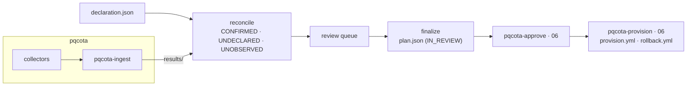

English · [한국어](README.ko.md)

# pqcaton

**Overview** · [Release notes](RELEASE_NOTES.md) · [Journey](docs/journey.md) · [Design](docs/developers.md) · [Acceptance criteria](docs/testcases.md) · [Demo](demo/README.md) · [Structure diagram](#how-it-fits-together)

> **`main` is under development for v0.30.0.** It takes in upstream pqcota v0.14.0 (the ruleset stays `pqcota-enrich/v4`). For
> operation use the [v0.29.1 tag](https://github.com/sntsoftgit/pqcaton/tree/v0.29.1) with pqcota v0.13.0.

**The place to decide what to change in a PQC migration.** [pqcota](https://github.com/randyinthedev-hash/pqcota) observes which
cryptography your systems use; pqcaton **reconciles those observations with what your organization declared, puts what needs a decision
in a review queue, and finalizes the decisions people make** into a plan pqcota can approve and carry out. This version is used with
pqcota **v0.14.0** ([version table](docs/compatibility.md)).

> **Source-available, not open source.** It is [BUSL-1.1](LICENSE): free up to 5 managed nodes, a contract beyond that, and **each
> release converts to Apache-2.0 four years later** ([license guide](docs/licensing.md)).

## Who this page is for

- **Operators** who run a PQC migration inside an organization and must show who decided what, when and on which evidence.
- **Security teams** who want to see communication nobody declared before anything changes.
- **Approvers and auditors** who receive the plan and need to trace every action back to an observation and a human judgment.

You do not need to read code. The screen (`pqcaton-ui`) walks through the steps, and the commands do the same work for scripts.

## What you receive

| You receive | What it is |
|---|---|
| **A three-state inventory** | Every asset and connection as CONFIRMED (declared and observed), UNDECLARED (observed only, the organization does not know about it) or UNOBSERVED (declared only, left for a person to judge) |
| **A review queue** | What needs a human decision, with batch decisions per policy and individual review where it matters |
| **A judged plan** (`plan.json`) | In pqcota's contract format, `IN_REVIEW`, each action carrying the snapshot evidence it came from. Approving execution stays a separate step |
| **An append-only judgment ledger** | Who judged what, when and why, re-checked only where the evidence changed |
| **An approved asset scope** (`asset-scope.csv`) | "What we do not look at", approved like any other decision; it is the input of pqcota's enforcer |

## The three stages

1. **Declare and observe.** The organization writes down what it believes it runs (from a CMDB or by hand). pqcota observes the nodes and
   ingests the results.
2. **Reconcile and review.** pqcaton matches observation with declaration in three states and puts what needs a decision in the review
   queue. People judge per policy or per item.
3. **Finalize and hand over.** Finalizing passes a gate only with every mandatory judgment and a signature. The plan then goes to pqcota
   for approval and generation (`pqcota-approve`, `pqcota-provision`), or through the 06 screen on the same machine.

### How it fits together



The dependency goes **one way**: pqcaton uses pqcota's public modules, and pqcota does not depend on pqcaton. pqcota is complete on its
own. A longer architecture page is [docs/index.html](docs/index.html).

## Quick start

<a id="써보기"></a>

You need **Go** (the version in [`go.mod`](go.mod)) and, for observation, approval and generation, pqcota **v0.14.0** with its five
repositories at the same tag. Graphviz (`dot`) is optional; without it the topology comes out as DOT source.

**Around once on this machine (Linux).** The shortcut scans this machine itself (`/proc`); on macOS and Windows, reconcile the
`results/` pqcota gathered instead.

```bash
make
go build -o bin/ ./inventory/cmd/...
printf 'node,runtime,component\nlocal,openssl,libssl\nlocal,jca,jca-provider-chain\n' > decl.csv
bin/pqcaton-decide open decl.csv local > session.json
bin/pqcaton-decide close session.json -o plan.json -judgments judgments.jsonl -org acme
bin/pqcaton-decide delta judgments.jsonl decl.csv local -org acme
```

Between `open` and `close`, a person fills in the conclusions, the reviewer and the signature in `session.json` (or on the screen).
`close` refuses and lists what is left until every mandatory item is judged.

**On the screen.** Start `pqcaton-ui` with no arguments: it uses the `pqcaton` workspace in your home folder and opens a browser. **It
does not start without the pqcota history**: `PQCOTA_DSN` in the shell, or `pqcota.env` in the user configuration folder. Installation,
the service, backup, recovery and the error table are in the [operator guide](docs/operator-guide.md).

```bash
pqcaton-ui
```

## Where to go next

| To | Read |
|---|---|
| Install and run it day to day | [Operator guide](docs/operator-guide.md) |
| Follow the whole procedure with every command | [Journey](docs/journey.md) |
| See why it is built this way | [Design](docs/developers.md) · [Acceptance criteria](docs/testcases.md) |
| Try it on the pqcota demo | [Demo](demo/README.md) |
| Pick the pqcota version | [Version table](docs/compatibility.md) |
| Build from source, look up an environment variable | [Build](docs/build.md) · [Environment variables](docs/environment-variables.md) |
| See what leaves when hosted | [`saas/runner`](saas/runner/README.md) |
| Send a fix · report a vulnerability | [CONTRIBUTING](CONTRIBUTING.md) · [CLA](CLA.md) · [SECURITY](SECURITY.md) |

## Matching versions

This repository is built with pqcota **v0.14.0** (`pqcota-common`, `pqcota-inventory`, `pqcota-discovery` and `pqcota-provisioning` at the
same tag, pinned in `go.mod`) and was checked end to end with it. pqcaton normalizes observations with
the ruleset built into it (`pqcota-enrich/v4`) and carries those snapshot fingerprints as the evidence of plans, so upstream's
`pqcota-ingest` and `pqcota-provision` must use the same ruleset. For pqcota v0.10.6 to v0.11.0, whose ruleset is v3, use pqcaton
[v0.28.0](https://github.com/sntsoftgit/pqcaton/tree/v0.28.0); for v0.10.5 or earlier, use pqcaton
[v0.24.1](https://github.com/sntsoftgit/pqcaton/tree/v0.24.1). Every combination is in the
[version table](docs/compatibility.md).

## What pqcaton does not do

| It does not | Instead |
|---|---|
| Collect | pqcota's collectors observe; the screen only runs them with your Ansible |
| Apply changes | The screen generates playbooks with pqcota's generator; your Ansible applies them |
| Judge for you | It structures what is to be judged; **people finalize** |
| Decide UNOBSERVED | Whether something exists but was not seen, or is gone, only people know |

## License

Copyright 2026 SNT Soft Co., Ltd. The copyright holders are listed in [AUTHORS](AUTHORS).

[**BUSL-1.1**](LICENSE) · **each release converts to Apache-2.0 four years after its publication.** The conversion date of each version
is in the [release notes](RELEASE_NOTES.md), for the versions before the English edition began in the Korean edition
[RELEASE_NOTES.ko.md](RELEASE_NOTES.ko.md) (v0.1.0 to v0.5.0: 2030-08-11).

- Evaluation, development and testing are free without a size limit
- Production is free up to 5 managed nodes
- Beyond that, a contract: **kty@sntsoft.co.kr**

Details are in the [license guide](docs/licensing.md). The base project pqcota is Apache-2.0, and the attribution notice is in
[NOTICE](NOTICE). Documents are in English by default with Korean pairs (`*.ko.md`); for the CLA, the Korean original
([CLA.ko.md](CLA.ko.md)) governs.

---

SNT Soft Co., Ltd.
